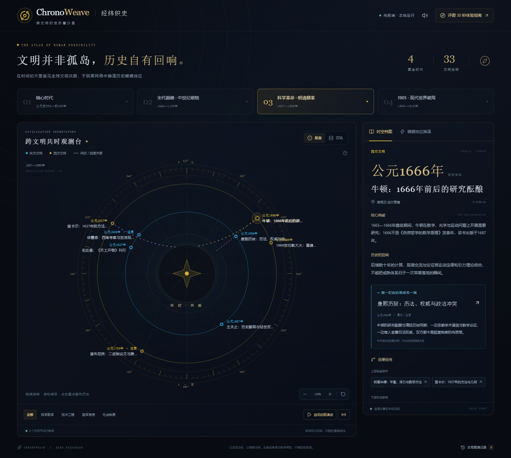

<div align="center">

# ChronoWeave · 经纬织史

跨文明时空折叠与蝴蝶效应推演沙盘，让历史可以对照，让假设有据可循。

    

</div>

## 一分钟看懂

| 项目 | 说明 |
| :--- | :--- |
| **项目** | ChronoWeave 经纬织史 · 面向 2026 Qoder 高校创造力大赛 StudyHack 学习科研赛道构建 |
| **在线演示** | [打开跨文明时空沙盘](https://chronoweave-m33wci77q34.qoder.zone) · 无需应用账号 |
| **GitHub** | [Waffing / ChronoWeave](https://github.com/Waffing/ChronoWeave) |
| **技术栈** | React · TypeScript · Vite · Tailwind CSS · Lucide · 原生 SVG / Canvas / Web Audio |



## 核心功能

| 功能 | 体验 |
| :--- | :--- |
| **四大黄金时代** | 轴心时代、宋代与中世纪、科学革命与明清鼎革、1905 与现代世界；共 33 个历史节点 |
| **双环文明星盘** | 青蓝东方内轨与古金西方外轨，支持节点选择、拖拽旋转、滚轮缩放和重置 |
| **平行双轨时间轴** | 按年代对照东西方事件，配合科学数学、技术工程、哲学思想、社会制度筛选 |
| **时空档案** | 年份、地点、突破、历史意义、异侧对照、上下游标签与史料阅读线索 |
| **蝴蝶效应沙盘** | “未发生”与“推迟 200 年”两种情景，三层冲击链、递归传播、五维雷达与延迟估值 |
| **机械星盘微音效** | Web Audio 原生合成节点嘀嗒、旋转齿轮与推演共鸣，顶部一键静音 |
| **高清 PNG 手札** | 原生 Canvas 绘制历史节点、跨文明对照、三层推演和雷达图，直接下载 |
| **巡航与本地记录** | 自动推进节点、文字简评、可选系统中文朗读；偏好与推演记录保存在本机 |
| **30 秒体验引导** | 可关闭、可重开的四步引导，支持移动端布局与减少动态效果偏好 |

> **史实与模型边界**：年代邻近不等于因果关系；部分指定事件作为邻近延展节点保留真实年份。三层反事实、五维分数和延迟年限属于启发式教学情景，不是确定性历史预测或学界测量。每个节点附有史料或阅读线索；系统朗读依赖浏览器及本机中文语音资源。

## 快速开始

需要 Node.js **22.13+（22 系列）或 24+**，以及 npm。

```bash
npm install
npm run dev
```

打开终端输出的本地地址，即可体验。首次交互后，浏览器允许时激活合成音效；无需填写密钥或启动后端。

```bash
npm run verify   # 数据、传播模型、存储、音效与导出逻辑检查
npm run build    # TypeScript 检查与生产静态构建
npm run preview  # 预览 dist 中的生产版本
```

生产部署只需要 `dist/` 静态文件，不需要服务器函数。运行中的应用不加载外部图片、音频或字体；README 徽章仅用于 GitHub 展示。

## 项目结构

```text
ChronoWeave/
├── src/
│   ├── App.tsx                 # 时代、视图、巡航与推演状态协调
│   ├── globals.css             # 黑金星盘视觉、响应式与动态效果
│   ├── data/
│   │   └── chronoData.ts       # 33 个完整节点、关系与专属教学情景
│   ├── components/
│   │   ├── Astrolabe.tsx       # SVG 双环星盘
│   │   ├── Timeline.tsx        # 平行双轨时间轴
│   │   ├── DetailPanel.tsx     # 档案与蝴蝶效应面板
│   │   ├── RadarChart.tsx      # 五维 SVG 雷达
│   │   └── Guide.tsx           # 四步体验引导
│   └── lib/
│       ├── simulation.ts       # 影响传播与两类情景计算
│       ├── storage.ts          # 本地状态持久化
│       ├── audio.ts            # 原生机械音效
│       └── exportCard.ts       # Canvas 高清手札导出
├── scripts/
│   ├── verify-data.mjs         # 数据完整性与年代校验
│   ├── verify-behavior.mjs     # 推演与存储校验
│   ├── verify-audio.mjs        # 音效调度与边界检查
│   ├── verify-export.mjs       # 导出绘制逻辑检查
│   └── browser-acceptance.py   # 独立 Chromium 交互验收
├── artifacts/                  # 实际界面截图、导出样张与验收结果
├── components/                 # Starter 随附 UI 组件
├── dev/ · functions/           # Starter 随附示例，应用运行不依赖
├── index.html                  # 静态入口与站点元信息
└── vite.config.ts              # Vite 静态构建配置
```

## 技术栈

| 层次 | 技术 | 用途 |
| :--- | :--- | :--- |
| 界面 | React 19 · TypeScript 5.9 | 组件、交互状态与类型约束 |
| 构建 | Vite 8 | 本地开发与静态资源打包 |
| 样式 | Tailwind CSS 4 · CSS | 黑金配色、毛玻璃面板、响应式布局 |
| 图形 | 原生 SVG · Canvas 2D | 星盘、流光连线、雷达与 PNG 手札 |
| 声音 | Web Audio API | 无音频文件的机械微音效 |
| 图标 | Lucide React | 矢量图标 |
| 存储 | localStorage | 设备本地偏好与最多 50 条推演记录 |
| 部署 | Qoder Sites | 纯静态公开演示 |

## 验证与预览

本地验收使用全新隔离的 Chromium，覆盖节点选择、领域筛选、拖转缩放、双轨切换、两种推演、跨时代保留、刷新恢复、巡航、静音和 PNG 下载。测试期间页面异常与外部资源请求均为 0；这不替代所有浏览器与设备的兼容性保证。

| 资料 | 链接 |
| :--- | :--- |
| 双轨时间轴 | [查看截图](artifacts/chronoweave-timeline.png) |
| 蝴蝶效应 | [查看截图](artifacts/chronoweave-simulation.png) |
| 移动端 | [查看截图](artifacts/chronoweave-mobile.png) |
| 导出样张 | [牛顿时空推演手札 · PNG](artifacts/ChronoWeave-newton-removed.png) |
| 浏览器记录 | [查看验收 JSON](artifacts/browser-acceptance.json) |

应用不上传你的推演记录。localStorage 属于当前浏览器与站点来源，清除站点数据会移除本地记录。
